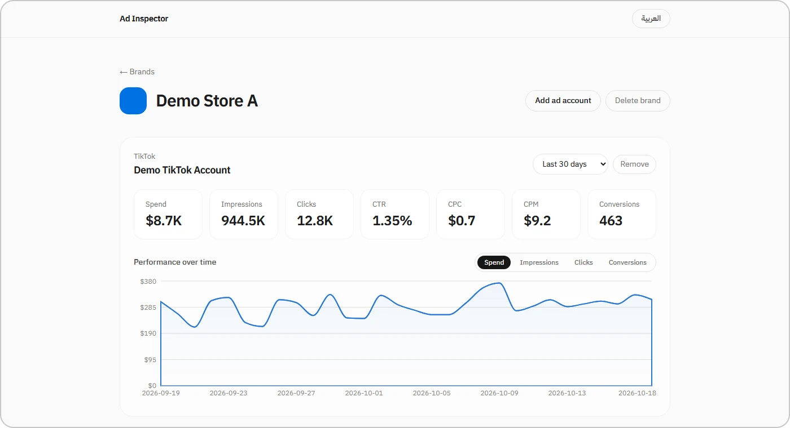
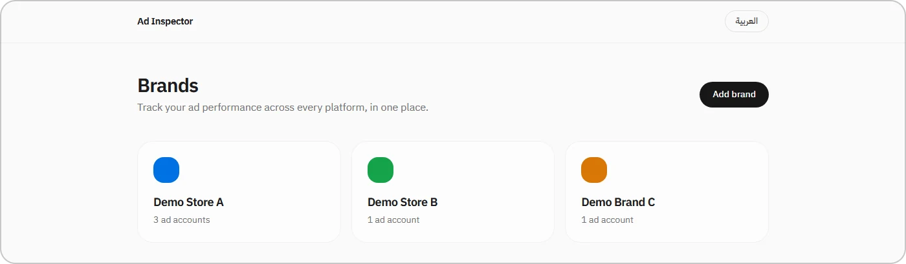

# Ad Inspector

**One dashboard for every ad account: spend, reach and conversions across TikTok, Snapchat, Meta and more, grouped by brand.**



## The problem

Running ads for several brands means logging into a different ads manager for each platform, each with its own metrics and date pickers. Comparing performance quickly turns into copying numbers into a spreadsheet.

## The solution

- **Brands → ad accounts.** Group each brand's accounts across platforms (TikTok, Snapchat, Facebook, Instagram, Google Ads, LinkedIn, Pinterest).
- **Standard KPIs per account.** Spend, impressions, clicks, CTR, CPC, CPM and conversions.
- **Performance over time.** A daily chart you can switch between spend, impressions, clicks and conversions.
- **Per-account date ranges.** Last 7, 30 or 90 days, all time, or a custom range.
- **Bilingual.** Arabic (RTL) and English.

## How it works

```
Ad platforms (TikTok · Snapchat · Meta · Google Ads · …)
        │
        ▼
Windsor.ai API (one connector layer for all platforms)
        │  server-side, API key never reaches the browser
        ▼
Next.js API routes ──▶ aggregate rows into KPIs + daily series
        │
        ▼
Dashboard (React + Recharts)  ·  brands & accounts stored with Prisma + SQLite
```

## Tech stack

Next.js · React · TypeScript · Prisma · SQLite · Recharts · Windsor.ai API

## Screenshots



*All brands, accounts and numbers shown are invented demo data.*

## Status

🛠️ **In development**

---

Source code is private and available on request. More about me: [Abdullah-Albariqi](https://github.com/Abdullah-Albariqi)
